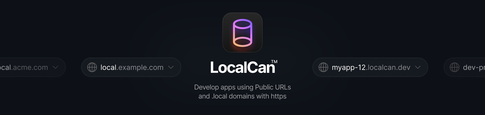

<p align="center">
  
</p>

<h3 align="center">The ngrok alternative with .local domains, a scriptable CLI, and an MCP server for AI agents</h3>

<p align="center">Desktop app for macOS and Windows &nbsp;·&nbsp; CLI for every platform &nbsp;·&nbsp; Free plan</p>

<p align="center">
  <a href="https://www.localcan.com/download"><b>Download</b></a> ·
  <a href="https://www.localcan.com/docs">Docs</a> ·
  <a href="https://www.localcan.com/changelog">Changelog</a> ·
  <a href="https://www.localcan.com/pricing">Pricing</a>
</p>

LocalCan puts your local app on the internet with a Public URL (also known as a tunnel) and on your local network with a `.local` domain, both over HTTPS. For 3.0, LocalCan was rewritten from the ground up: the engine is now a Go daemon behind a multi-region edge network. The desktop app on macOS and Windows, the CLI on all three platforms, and the MCP server for AI agents all drive that same engine and share the same YAML config.

## Features

- **Public URLs**: share localhost at an address like `https://my-app.localcan.dev`. Pause and resume them. A paused URL stays reserved for up to 7 days.
- **Custom domains**: run Public URLs on a domain you own, with the SSL certificate lifecycle handled for you. Custom domains never expire.
- **TCP tunnels** for databases, SSH, and other non-HTTP services.
- **`.local` domains**: reach a local app at `https://my-app.local` instead of `localhost:3000`, advertised to your network over mDNS (Bonjour). Wildcard subdomains like `*.my-app.local` work, and so do WebSockets, so hot reload in Vite and Next.js keeps working.
- **Automatic HTTPS**: a local root CA signs your `.local` domains (trust it once, and you can install it on an iPhone or a simulator too), and Public URLs are always HTTPS.
- **Traffic inspector**: watch requests flow through your domains and Public URLs, replay them, and copy any exchange as cURL, HAR, HTTP, JSON, or Markdown for AI.
- **Snapshots**: publish a static copy of your app that stays online at the same Public URL while your machine is off.
- **Access control**: protect a Public URL with a password page, a secret link, or IP and user-agent rules, enforced on LocalCan's servers so protection keeps working while your machine sleeps.
- **MCP server**: AI agents can inspect captured traffic, manage Public URLs, publish Snapshots, and password-protect what you share.
- **CLI and YAML config**: everything above is scriptable, with `--json` output for piping into `jq` or CI.

## Install

**macOS**: download the `.dmg` from [localcan.com/download](https://www.localcan.com/download). The daemon is bundled inside the app, and on first launch it offers to install the `localcan` command line tools.

**Windows**: download the `.exe` installer from [localcan.com/download](https://www.localcan.com/download). Install Bonjour Print Services so `.local` domains resolve (see the [installation notes](https://www.localcan.com/docs/installation)).

**Linux** (CLI only):

```sh
curl -fsSL https://localcan.com/install.sh | sh
```

Linux has no desktop UI, and `.local` domains are not advertised over mDNS there. The [installation notes](https://www.localcan.com/docs/installation) cover the differences.

Coming from LocalCan 2.x? Version 3.0 installs side-by-side with 2.x and asks on first launch what to bring over. See the [installation notes](https://www.localcan.com/docs/installation).

## Quick start with the CLI

Every plan, including [Free](https://www.localcan.com/pricing), issues a license key. Activate it, then point a Public URL at your local app:

```sh
localcan license activate localcan_xxxxxxxxxxxxx
localcan http 3000
```

```plaintext
Connecting tunnel to http://localhost:3000...
Forwarding https://swift-falcon.local → localhost:3000
Forwarding http://swift-falcon.local → localhost:3000
Forwarding https://swift-falcon-12.localcan.dev → localhost:3000

Requests (Ctrl+C to stop):

15:04:21    GET 200  /
15:04:21    GET 200  /_next/static/css/app.css
```

On the Free plan the Public URL lives on the trylocalcan.com domain and rotates each session. Paid plans get a reserved `*.localcan.dev` address like the one above.

Without any license, `localcan http 3000` still works out of the box and publishes a `.local` URL for your local network. Public URLs and TCP tunnels need an activated key.

Prefer a UI? Follow the [Quick start](https://www.localcan.com/docs/quick-start) with the desktop app instead.

## Configure with YAML

Everything LocalCan persists lives in `~/.localcan/`. One YAML file per project, editable by hand, shared by the desktop app and the CLI:

```yaml
# ~/.localcan/projects/my-app.yml
name: My App
icon: 🚀

services:
  web:
    target: http://localhost:3000
    endpoints:
      - provider: localcan   # Public URL, leave url empty to auto-assign one
      - url: my-app.local    # local domain for your network
```

Run `localcan reload` to apply hand edits. The assigned Public URL is written back to the file, so the config stays the source of truth. Endpoints can also declare header rewrites, basic auth, Snapshots, and Access control. See the [configuration docs](https://www.localcan.com/docs/configuration).

## AI agents

LocalCan ships an MCP server, so an AI agent can debug webhooks and share your work for you:

```sh
claude mcp add --scope user localcan -- localcan mcp
```

The server works with Claude Code, Codex, Cursor, Claude Desktop, VS Code, Zed, and any other MCP host. Then ask things like:

- "A webhook just failed in LocalCan. Find it and explain why."
- "Expose port 3000 publicly and give me the URL."
- "Password-protect that preview and give me the password to send."

The defaults are safe: sensitive headers (Authorization, cookies, API keys) are redacted from agent responses, and write tools stay off until you enable them with `localcan mcp access read_write`. See the [AI agents docs](https://www.localcan.com/docs/ai-agents).

## Plans

The **Free plan** includes one live Public URL at a time with 60-minute sessions and 1 GB of traffic per month, plus unlimited `.local` domains, automatic HTTPS, the traffic inspector, and the MCP server. No credit card is required. [Sign up free](https://www.localcan.com/dashboard/get-started?plan=free).

**Paid plans** add Public URLs on `*.localcan.dev` that stay reserved between sessions, custom domains, TCP tunnels, Snapshots, and Access control. They start with a 14-day free trial. Teams adds team Access policies plus SSO and SCIM. See [pricing](https://www.localcan.com/pricing).

## Community and support

- Share [feature requests](https://github.com/LocalCan/LocalCanApp/discussions/categories/feature-requests) and ask [questions](https://github.com/LocalCan/LocalCanApp/discussions/categories/general) in Discussions.
- Report bugs on the [issue tracker](https://github.com/LocalCan/LocalCanApp/issues).
- Email [support@localcan.com](mailto:support@localcan.com) for anything private.

LocalCan is a closed-source commercial product. This repository is its public home for issues, discussions, and community. Downloads live at [localcan.com/download](https://www.localcan.com/download).
